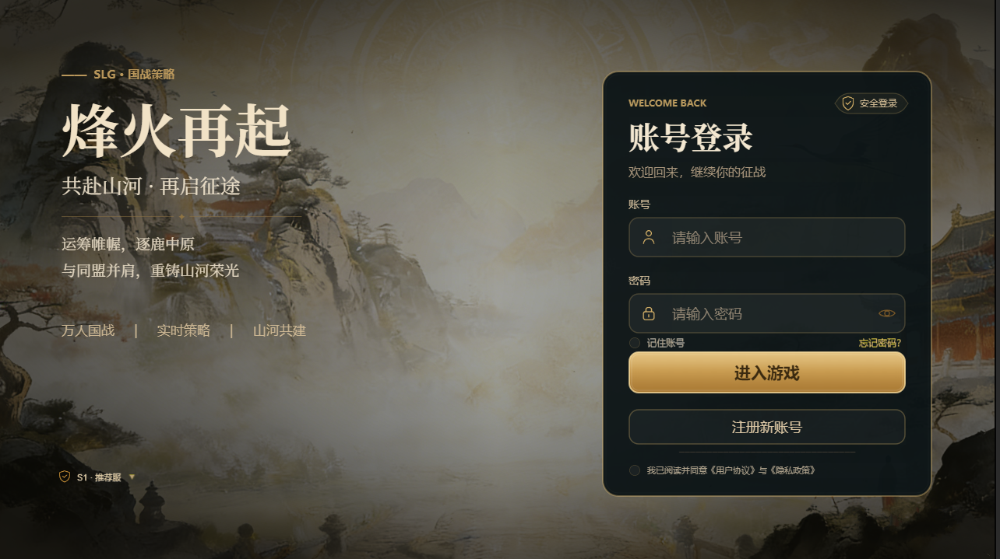
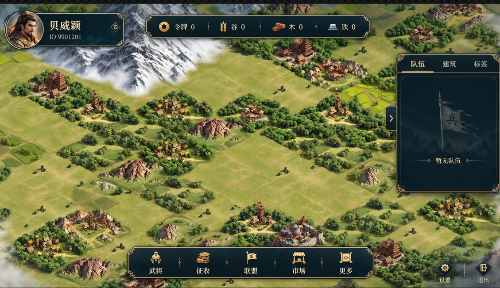
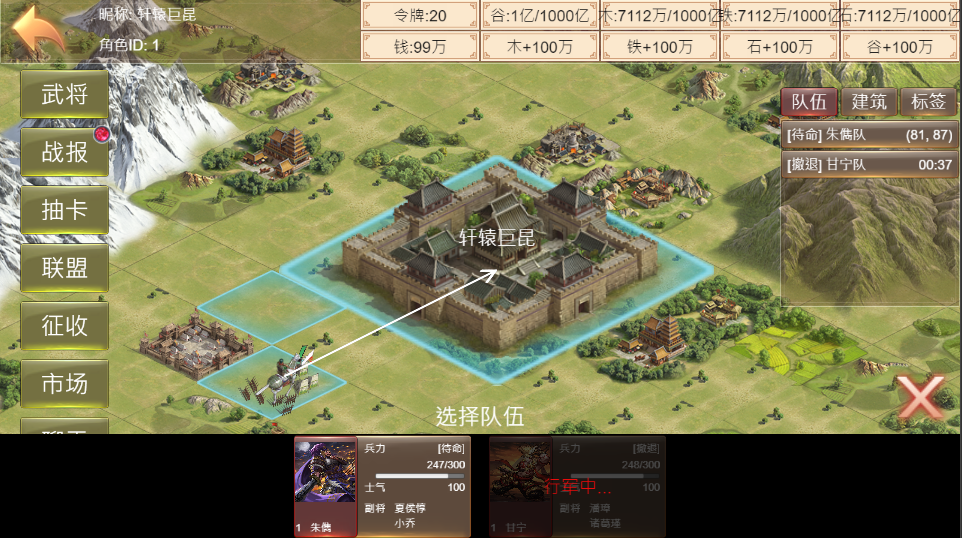
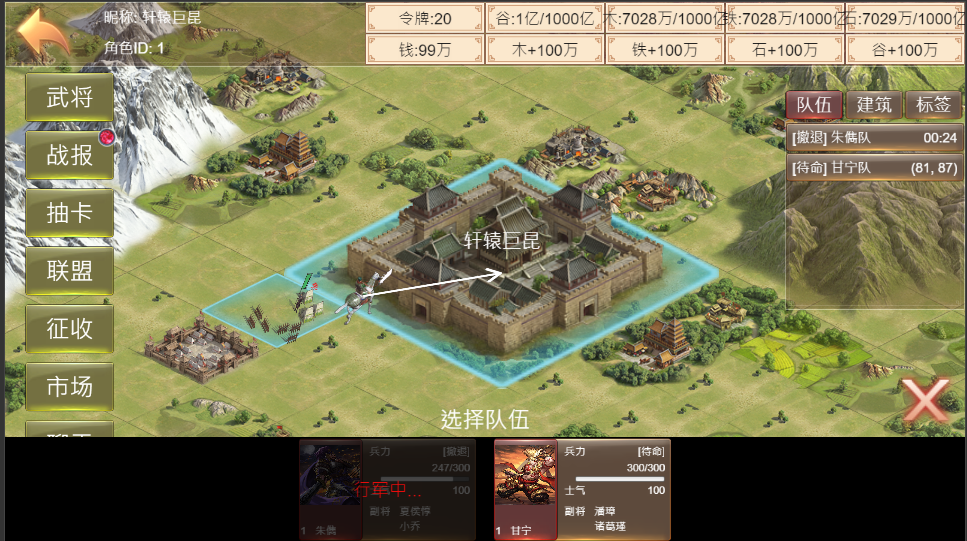
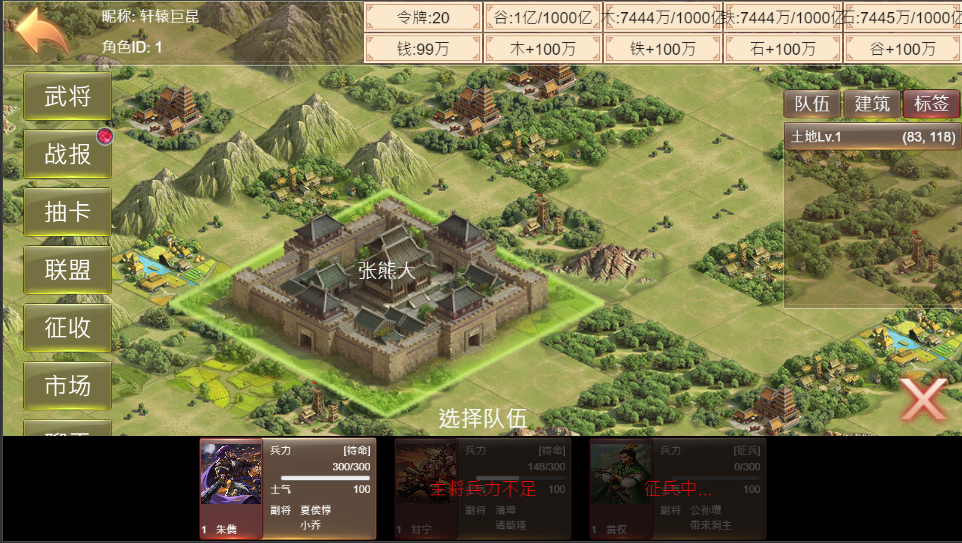
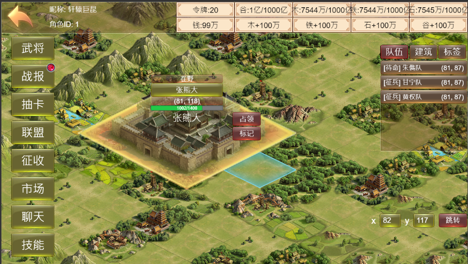
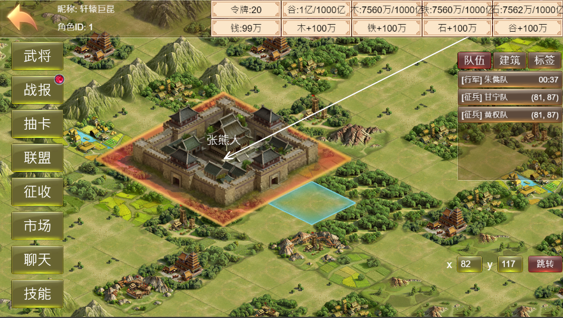
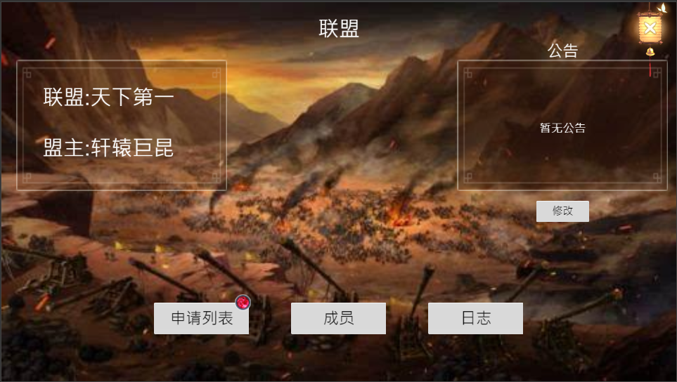
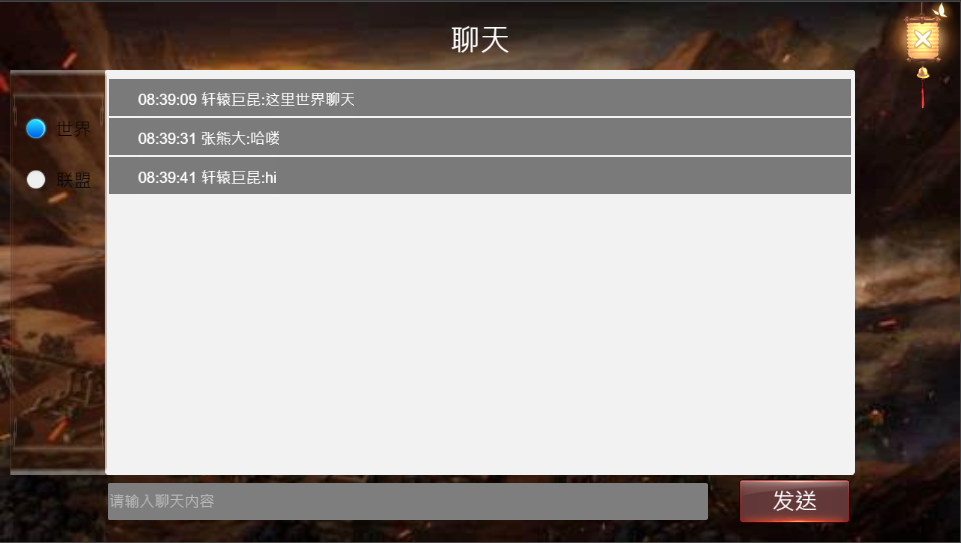

# slg游戏客户端 demo

三国题材 SLG 客户端，使用 **Cocos Creator 3.8.8** 开发。设计分辨率 1280×720。

素材来源于网络，仅供学习使用，请勿用于商业用途。

仓库：https://github.com/literwave/slg_game_client.git

服务端：https://github.com/literwave/slg_game.git

如果对这个项目感兴趣，欢迎加入 QQ 群一起交流：204727149。

## 运行

用 Cocos Creator 3.8.8 打开本项目，预览 `MainScene`。

启动后先初始化 Protobuf，再进入登录页。登录成功并进入服务器后，加载大地图。

## 连接服务端

服务端部署完成后，修改 `assets/scripts/config/GameConfig.ts`：

```typescript
import { _decorator } from 'cc';
const GameConfig = {
    serverUrl: "ws://127.0.0.1:33022",
    webUrl: "http://127.0.0.1:8088",
    loginUrl: "ws://127.0.0.1:33021"
}
export { GameConfig };
```

| 字段 | 用途 |
| --- | --- |
| `loginUrl` | 登录服 WebSocket。登录页打开时连接，完成账号登录。 |
| `serverUrl` | 网关 WebSocket。进入服务器时连接。 |
| `webUrl` | HTTP 服务地址。 |

登录页支持记住账号、显示或隐藏密码，需要勾选用户协议后才能登录。选服列表只保存显示名称，实际连接地址仍以 `GameConfig` 为准。

## 界面

### 登录



### 大地图

进入服务器后的主界面。左上角是角色，上方是资源，右侧是队伍，底部进入武将、征收、联盟等功能。



### 占领领地

选择待命队伍出征占领。



### 出征返回

队伍撤回主城。



### 友方主城



### 敌方主城



### 军队前往敌方主城



### 联盟



### 聊天

世界频道与联盟频道。



## 配置表

游戏数值的源表在 submodule [`external/game_common`](https://github.com/literwave/game_common)，前端导出是 `client/res/*.json`。客户端运行时读的是拷贝到 `assets/resources/config` 的那份。这些 JSON 是配置文件，AI 可以读，不能改。

`git submodule update --remote` **只更新 submodule 指针**，不会往 `assets/resources/config` 拷文件。所以 `git status` 里出现 `modified: external/game_common (new commits)` 时，config 可能还是旧的。

拉最新 common 并拷进客户端，用：

```powershell
tools/sync-game-common.ps1
```

脚本会：

1. 执行 `git submodule update --init --remote -- external/game_common`（没初始化过时必须带 `--init`，否则 `--remote` 会静默跳过）。
2. 把 `client/res/*.json` 拷到 `assets/resources/config`，把 `proto` 和 `client/net_pb.json` 拷到 `assets/resources/protbuf`。
3. 给 submodule 安装 `post-checkout` 钩子。装过之后，再跑 `git submodule update --remote` 会自动拷贝。

钩子只存在本机 `.git` 里，不进仓库。新克隆或钩子丢了，再跑一次脚本。不要只跑 `git submodule update --remote` 就当表已经进客户端。

改表在 `game_common` 里做，不要直接改 `assets/resources/config`。表里的 `Icon` 写成 `assets/resources/ui` 下的路径，不要写扩展名，例如 `"Icon": "ui/item_icons/speed_up"`，对应 `assets/resources/ui/item_icons/speed_up.png`。

`.agents/` 不进仓库。其他开发者在项目里新建 `.agents/skills/game-config/SKILL.md`，把下面的内容放进去，AI 就会按这个限制工作：

```markdown
---
name: game-config
description: >-
  Read game tables under assets/resources/config without editing them.
  Use when reading or changing config, Global.json, SystemOpen.json,
  or any JSON game table, or when the user mentions 配置.
---

# Game config

`assets/resources/config` 里的文件是配置文件。可以读，不能修改。

## 可以做

- 读取 `assets/resources/config` 下的 JSON，按现有字段写逻辑。
- 字段缺失时按缺省处理，不要补写配置。

## 不能做

- 不能修改、新增、删除、重排或格式化 `assets/resources/config` 里的文件，包括同目录的 `.meta`。
- 不能用同步脚本覆盖这些文件。
- 用户没有明确要求改配置时，也不要改。

需要改表时停下来，说明要改哪张表、哪个字段，等用户自己改配置。
```

## 提交说明

生成提交说明时读的是仓库根目录的 `.cursorrules`，不是 Skill，也不是 `.cursor/rules`。文件已放在项目里，内容是：

```markdown
# Commit messages

All generated commit messages must be written in Simplified Chinese (简体中文).

Format:
- First line: one concise Chinese summary of why/what changed (imperative / 陈述句均可)
- Optional body: short Chinese bullets if needed
- Do not use English Conventional Commit prefixes like feat:/fix: unless the user asks

Match recent repo history style (short Chinese one-liners).
```

## Cocos AI Copilot

可选的编辑器插件，不随仓库提交。每个开发者在本机安装，游戏构建和运行不依赖它。

要求：Cocos Creator 3.8.8，以及本机已安装的 Codex `0.160.1` 或更高稳定版。

1. 从 [Cocos AI Copilot v0.1.5](https://github.com/Renshuxian-ai/Cocos-ai-copilot/releases/tag/v0.1.5) 下载 `cocos-ai-copilot-0.1.5.zip`。
2. 关闭正在打开本项目的 Cocos Creator。
3. 如果项目里已有旧版，先删除整个 `extensions/cocos-ai-copilot` 目录，不要把新文件覆盖进旧目录。
4. 解压后把其中的 `extensions/cocos-ai-copilot` 放到项目根目录，最终路径为 `extensions/cocos-ai-copilot`。
5. 用 Cocos Creator 3.8.8 重新打开项目，从顶部菜单 **AI Copilot** 打开面板。
6. 在 **设置 → Runtime** 中确认 Codex 已连接，再到 **设置 → Cocos MCP** 确认版本为 `0.1.5`。

官方包每次跑终端命令或编辑器 MCP 都会弹出确认。重新解压后把下面这段交给 AI，让它直接改本地插件，不要改游戏代码：

在 `extensions/cocos-ai-copilot` 里加一个默认勾选的「默认直接运行命令」。自动放行终端命令 `item/commandExecution/requestApproval`，以及编辑器 MCP 审批 `mcpServer/elicitation/request`（改节点、跑 Preview 等）。修改文件、删除节点或资源仍要询问：`item/fileChange/requestApproval`，以及 MCP 工具 `write_file`、`replace_in_file`、`delete_node`、`delete_asset`。勾选状态记在 `localStorage` 的 `cocos-ai-copilot.autoApproveCommands`。

- `panel/activity-controller.js`：在 `pendingApprovalsForSession` 前增加开关和 `maybeAutoApproveActivity`；收到审批或渲染托盘时直接放行，并在命令卡片上放勾选框。
- `panel/index.js`：在 `renderPermissionMenu` 顶部放同一个勾选框；`approval-request` 到达时立刻尝试自动放行。
- `panel/chat-view.js`：给勾选框加样式，并把 `.permission-menu` 的最大高度调大，避免被裁切。

改完后关掉 AI Copilot 面板再打开一次。
