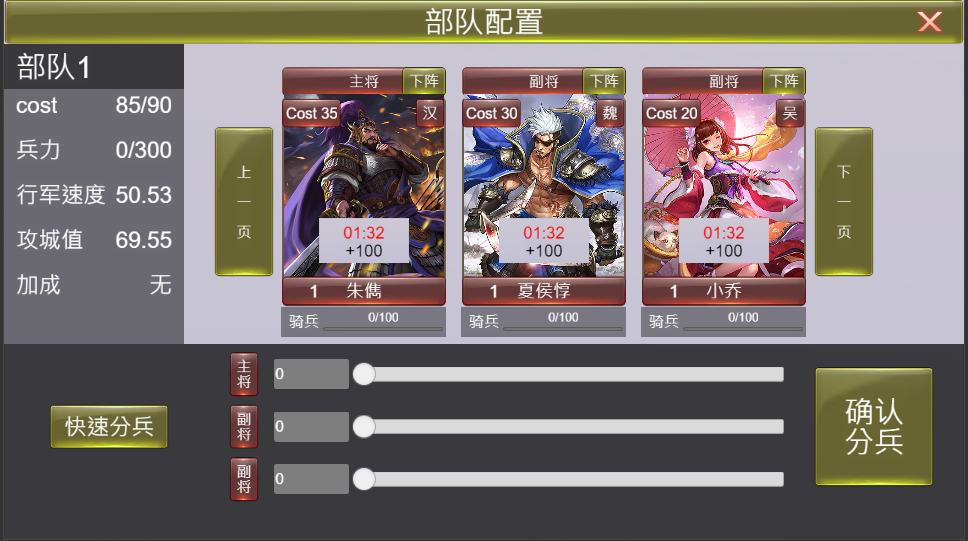
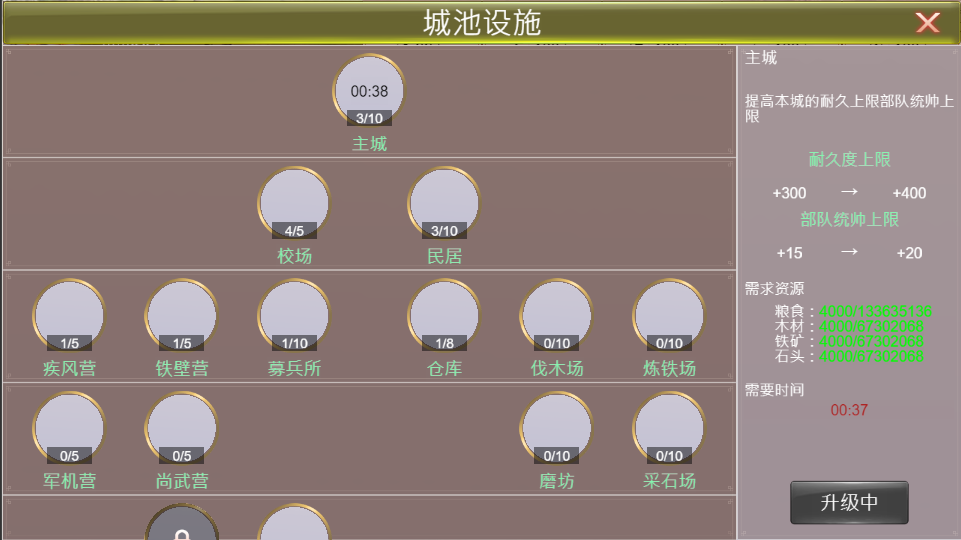
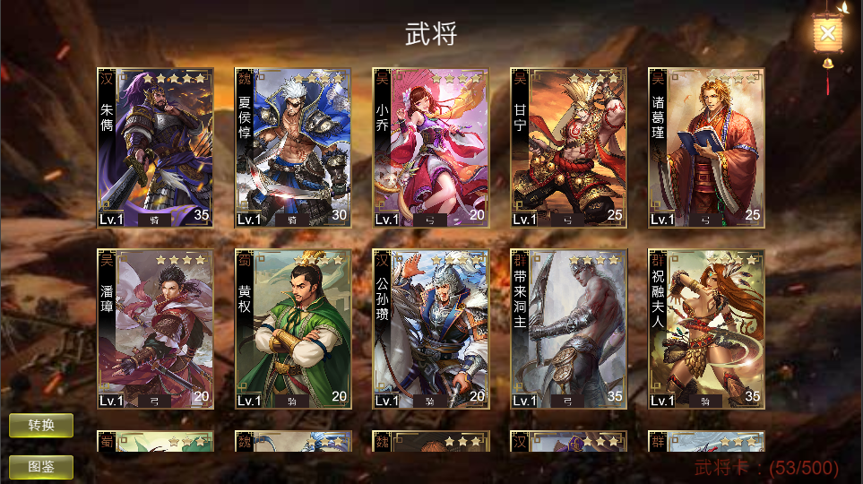
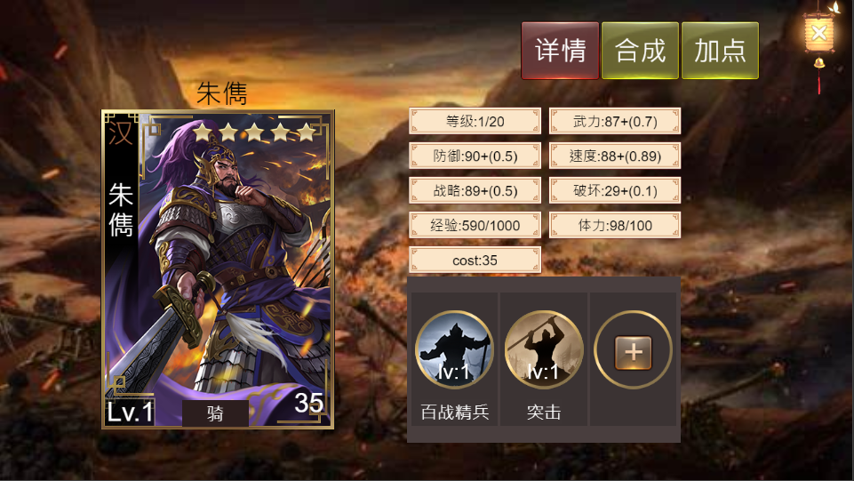
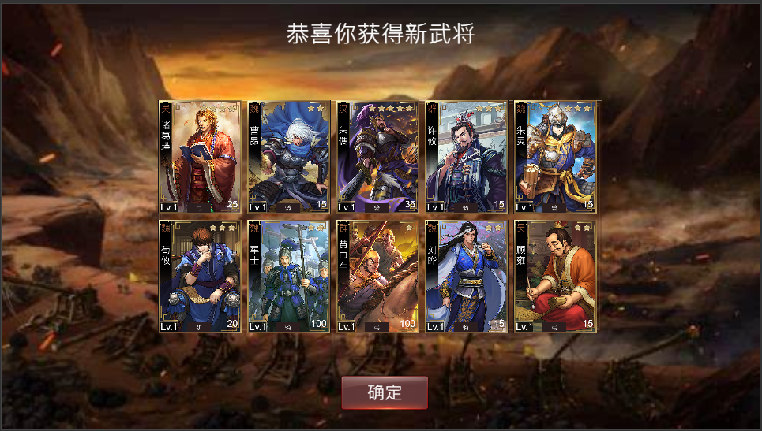
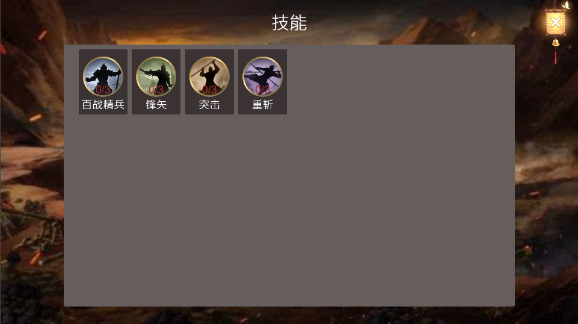
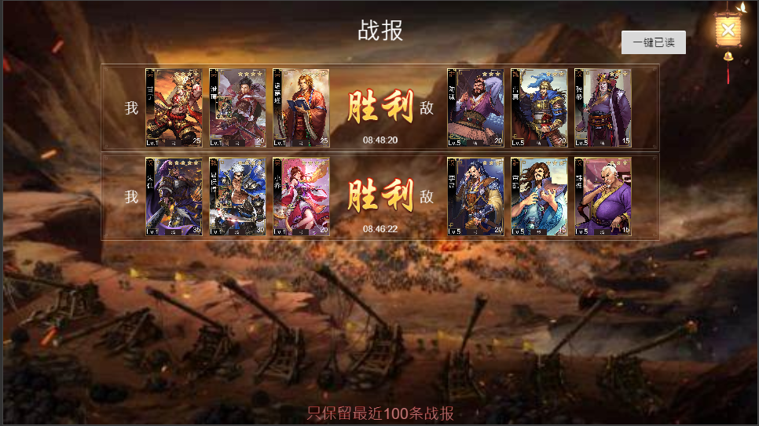

# slg游戏客户端 demo

三国题材 SLG 客户端，使用 **Cocos Creator 3.8.8** 开发。设计分辨率 1280×720。

素材来源于网络，仅供学习使用，请勿用于商业用途。

服务端 demo：https://github.com/literwave/game_demo.git

## 运行

用 Cocos Creator 3.8.8 打开本项目，预览 `MainScene`。

启动后先初始化 Protobuf，再进入登录页。登录成功并进入服务器后，加载大地图。

## 连接服务端

服务端部署完成后，修改 `assets/scripts/config/GameConfig.ts`：

```typescript
import { _decorator } from 'cc';
const GameConfig = {
    serverUrl: "ws://127.0.0.1:33022",
    webUrl: "http://127.0.0.1:8088",
    loginUrl: "ws://127.0.0.1:33021"
}
export { GameConfig };
```

| 字段 | 用途 |
| --- | --- |
| `loginUrl` | 登录服 WebSocket。登录页打开时连接，完成账号登录。 |
| `serverUrl` | 网关 WebSocket。进入服务器时连接。 |
| `webUrl` | HTTP 服务地址。 |

登录页支持记住账号、显示或隐藏密码，需要勾选用户协议后才能登录。选服列表只保存显示名称，实际连接地址仍以 `GameConfig` 为准。

## 界面

### 登录


### 部队配置

配置主将、副将并分配兵力。



### 占领领地

选择待命队伍出征占领。


### 出征返回

队伍撤回主城。


### 友方主城


### 敌方主城


### 军队前往敌方主城


### 城池设施

升级主城、校场、民居、兵营和资源建筑。



### 武将



### 武将详情

查看属性、技能，并可合成、加点。



### 抽卡结果



### 技能



### 战报



### 联盟


### 聊天

世界频道与联盟频道。


## Cocos AI Copilot

可选的编辑器插件，不随仓库提交。每个开发者在本机安装，游戏构建和运行不依赖它。

要求：Cocos Creator 3.8.8，以及本机已安装的 Codex `0.160.1` 或更高稳定版。

1. 从 [Cocos AI Copilot v0.1.5](https://github.com/Renshuxian-ai/Cocos-ai-copilot/releases/tag/v0.1.5) 下载 `cocos-ai-copilot-0.1.5.zip`。
2. 关闭正在打开本项目的 Cocos Creator。
3. 如果项目里已有旧版，先删除整个 `extensions/cocos-ai-copilot` 目录，不要把新文件覆盖进旧目录。
4. 解压后把其中的 `extensions/cocos-ai-copilot` 放到项目根目录，最终路径为 `extensions/cocos-ai-copilot`。
5. 用 Cocos Creator 3.8.8 重新打开项目，从顶部菜单 **AI Copilot** 打开面板。
6. 在 **设置 → Runtime** 中确认 Codex 已连接，再到 **设置 → Cocos MCP** 确认版本为 `0.1.5`。
